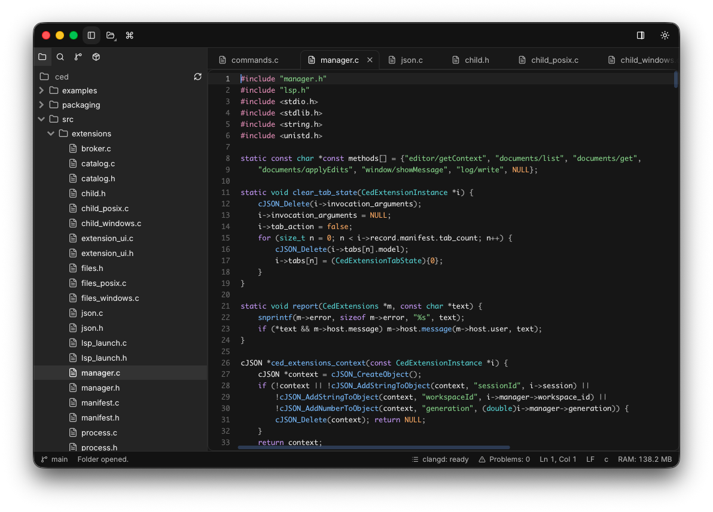

# CED

<p align="center">
  
</p>

A desktop text editor written in C99 with [CUI](https://github.com/yappologistic/CUI), organized around a VS Code-inspired workspace.



- **Files:** expandable file tree, file opening, project refresh, and context menus for creating, renaming, and deleting files and folders.
- **Search:** literal search in the background; click a result to open its line and column.
- **Git:** current branch, staged and local changes, side-by-side diffs, staging/unstaging individual files or all changes, confirmed discard of unstaged changes, commits with confirmation, push, and pull.
- **Editor:** multiple reorderable tabs, unsaved-change indicators, syntax highlighting, line numbers, indentation, undo/redo, copy/paste, in-file search, and go-to-line navigation.
- **Markdown:** rendered previews of the current buffer, including unsaved changes.
- **LSP:** clangd integration for C/C++, with diagnostics, completion, symbol information, and go-to-definition.
- **Terminal:** an interactive PTY shell in a resizable panel to the right of or below the editor.
- **Extensions (experimental):** reviewed local packages, workspace trust, lazy command activation in separate processes, and version-checked buffer edits with undo/redo.
- Resizable sidebar, light/dark themes, and a command palette.
- Status bar memory usage: the CED process's physical footprint on macOS (the metric used by Activity Monitor's Memory column), resident memory (RSS) on Linux, or working set on Windows, in MB (1 MB = 1,000,000 bytes). Refreshed every second; small differences can occur between tools due to sampling times. Shell and language-server child processes are excluded.

## Build and run

Requirements: GNU Make, CMake 3.20+, a C compiler, Git, and Perl 5 on your PATH. Perl generates libvterm's encoding headers during the build. The primary supported platforms are **macOS and Linux**. On Linux, install the X11 development headers (`libx11-dev` on Debian/Ubuntu); file dialogs require `zenity` or `kdialog`.

Experimental **native Windows** executables for x86, x64 and ARM64 can be cross-compiled through Docker. See [Docker build instructions](docker/README.md) and [Windows requirements and limitations](docker/WINDOWS.md). These builds use the Win32 backend and disable the experimental POSIX extension host.

Clone this repository with `git clone --recurse-submodules`, or initialize the submodules in an existing checkout before configuring:

```sh
make deps
make
make run
```

CUI, cJSON, and libvterm are Git submodules under `third_party/`. Their exact revisions are recorded as Git submodule references; URLs are recorded in `.gitmodules`. CMake builds those local checkouts and does not download dependencies. Run `make deps` again after checking out a revision that changes the dependency references. Generated libvterm headers stay in the build directory, leaving the submodule checkout clean. See [THIRD_PARTY.md](THIRD_PARTY.md) for revisions and licenses.

`make` (or `make build`) configures and builds the editor and tests in `build/`. Available targets:

| Target | Action |
| --- | --- |
| `make deps` | Initialize and update dependency submodules |
| `make configure` | Configure CMake with tests enabled |
| `make build` | Configure and compile the project |
| `make run` | Build and launch CED |
| `make test` | Build and run all tests |
| `make install` | Install `ced` and the platform application icon/launcher |
| `make install-macos` | Build and install `CED.app` into `/Applications` and `ced` into `PREFIX/bin` (macOS only) |
| `make clean` | Remove compiled outputs, keeping the CMake configuration |

Override `BUILD_DIR`, `BUILD_TYPE`, and `JOBS` to choose the output directory, CMake build type, and parallel build jobs. Defaults are `build`, `Release`, and `4`:

```sh
make BUILD_DIR=build-debug BUILD_TYPE=Debug JOBS=8
make test BUILD_DIR=build-debug BUILD_TYPE=Debug
```

Open a project and specific files:

```sh
make run ARGS='/path/to/project src/main.c README.md'
```

Pass paths containing spaces with inner quotes, for example `make run ARGS='"/path/to/my project" "notes file.md"'`. You can also launch the built executable directly with `./build/ced /path/to/project`.

The first argument is the project folder. Remaining arguments are file paths relative to that folder or absolute paths. With no arguments, the editor opens the current directory. On macOS, the build also creates `build/CED.app`, which you can open from Finder. Use **Open Folder** in the command palette or Mod Shift O to switch projects.

Click **Open** to choose one of the last ten folders, or select **Open Folder…** at the bottom to browse for a different directory. The **Open Recent Folder** command also opens this menu. Recent folders are kept across sessions.

## Install

On macOS, install the app with its Finder and Dock icon:

```sh
make install-macos
```

This installs `CED.app` into `/Applications` and the global command into `/usr/local/bin/ced`. For a per-user installation, use `make install-macos APPDIR="$HOME/Applications" PREFIX="$HOME/.local"`. The target also supports `BUILD_DIR` and `DESTDIR`. If the destinations require administrator permissions, build with `make` first, then run `sudo make install-macos`.

Each macOS installation replaces the complete app bundle and removes older CED bundles with the same bundle identifier from the chosen `APPDIR`. It also unregisters other CED copies (including build/test copies) from Launch Services and registers the installed app. Copies outside `APPDIR` are not deleted, and preferences in `~/.ced` are preserved. Close CED before upgrading so an already-running process does not keep the old executable in memory. Staged installations with `DESTDIR` do not modify Launch Services.

Install the `ced` command globally:

```sh
make install
ced /path/to/project
```

The default destination is `/usr/local/bin/ced`. If that directory requires administrator permissions, build with `make` first, then run `sudo make install`.

On macOS, installation also copies `CED.app` to `/Applications` (override with `APPDIR`). The bundle includes the terminal-inspired CED icon for Finder and the Dock; the standalone `ced` command embeds the icon too. On Linux, installation adds the application launcher and icon under `PREFIX/share`.

Choose another prefix with `PREFIX`, for example a per-user installation:

```sh
make install PREFIX="$HOME/.local"
```

For a per-user macOS app bundle, add `APPDIR="$HOME/Applications"` to that command.

Ensure the chosen prefix's `bin` directory is on your `PATH`. On Linux, a per-user prefix should be `$HOME/.local` so the desktop can also discover the launcher and icon. For packaging, `DESTDIR` stages the installation without changing the prefix: `make install DESTDIR=/tmp/ced-package PREFIX=/usr/local` writes `/tmp/ced-package/usr/local/bin/ced` and the platform resources under the same staging root. Installation copies the executable and resources, so it continues to work independently of the build folder.

## Keyboard shortcuts

`Mod` means Command on macOS and Ctrl on Linux.

| Shortcut | Action |
| --- | --- |
| Mod N | New file |
| Mod O | Open file |
| Mod Shift O | Open folder |
| Mod S | Save |
| Mod Shift S | Save as |
| Mod W | Close tab; prompts for unsaved changes |
| Ctrl Tab / Ctrl Shift Tab | Next / previous tab |
| Mod B | Toggle sidebar |
| Mod Shift E | File explorer |
| Mod Shift F | Project search |
| Mod Shift G | Git view |
| Mod Shift P | Command palette |
| Mod , | Open preferences JSON |
| Mod F | Find in the editor |
| Mod G | Go to line |
| Mod Z / Mod Shift Z | Undo / redo |
| Mod − / Mod + | Decrease / increase editor text size (8–32 px) |
| Mod Shift V | Toggle Markdown preview |
| Mod J | Toggle terminal |
| Ctrl Space or Mod Shift Space | Request completion |
| F12 | Go to definition |
| Mod Shift K | Symbol information |
| Tab / Shift Tab | Indent / unindent |

Text size is saved automatically to `~/.ced/settings.json` whenever you change the zoom and restored when CED starts, across all projects. Without a valid setting, the default is 14 px.

## Preferences

Press **Mod ,** or run **Open Preferences (JSON)** from the command palette to edit `~/.ced/settings.json`. The file is created with these defaults, importing any saved zoom and terminal position from the older `settings.conf`:

```json
{
  "editor.fontSize": 14,
  "editor.fontFamily": "Geist Mono",
  "editor.fontPath": "",
  "terminal.position": "bottom"
}
```

Save to apply changes. CED also checks external changes once per second; **Reload Preferences** forces a reload. Preferences apply across projects. Invalid JSON or invalid setting values keep the last valid configuration in use and display an error. Automatic zoom and terminal-position updates preserve unknown JSON fields and never overwrite an invalid preferences file. The legacy file is left untouched.

`editor.fontSize` accepts integers from 8 to 32. `terminal.position` accepts `"bottom"` or `"right"`. JSON must be an object without comments or duplicate keys, up to 64 KiB.

Set `editor.fontFamily` to an installed monospaced font, such as `"Menlo"` on macOS. Alternatively, set `editor.fontPath` to an absolute path or a path beginning with `~/` to a TTF, OTF, or TTC file; this takes precedence over the family name. Linux family lookup requires `fc-match` from fontconfig; a file path works without it. The built-in Geist Mono remains available without a system installation.

The selected font applies to the code editor and other monospaced surfaces, including diffs and the terminal. Missing, unsupported, or proportional fonts keep the previous font in use. To restore the default, clear `editor.fontPath` and set `editor.fontFamily` to `"Geist Mono"`. Font files are limited to 32 MiB; collections use their first face. Up to eight distinct font files can be loaded per session; restart CED to load more.

## File tree actions

Right-click a file or folder to open its context menu:

- **New File...** creates an empty file inside the selected folder, or in the parent folder of a selected file, and opens it in a tab.
- **New Folder...** creates a directory in the selected folder, or beside the selected file, and expands the resulting folder in the tree.
- **Rename...** renames the selected item. Renaming a folder also updates the paths of its open documents, preserving their unsaved contents.
- **Delete** permanently removes the selected file or folder after confirmation. The dialog identifies affected unsaved files before their tabs are closed. Folder deletion includes all its contents.

Existing destination names are never overwritten. The tree, search results, and Git status are refreshed after an operation. Right-click the project heading to create a file or folder at the project root; the root itself cannot be renamed or deleted through the menu.

## Git actions

The Git view provides **Stage All**, **Unstage All**, **Push**, and **Pull**. Bulk staging includes additions, modifications, and deletions across the repository and respects `.gitignore`. Unstaging clears the index while preserving working files, including before the first commit.

Each unstaged file has a **Discard Changes** icon. Confirmation restores tracked files from the index, preserving staged changes, or deletes the selected untracked file. Open buffers are reloaded or closed as appropriate; the confirmation warns when unsaved editor changes will also be lost. Conflicted files, directories and submodules are not discarded by this action.

Push and pull use Git's configured remote, upstream branch, and credential helpers. Pull uses `--ff-only`: divergent history produces an error instead of an automatic merge or rebase. Push uses normal Git behavior without requesting a force push. Remote operations run in the background; Git controls and project switching wait until they finish. Completion refreshes Git status, and a successful pull also refreshes the file tree. Open editor buffers keep their contents. Configure remotes and authentication through Git first; errors appear in the status bar.

## Markdown preview

Open a `.md` or `.markdown` file and click **Preview**, or press Mod Shift V. Click **Edit** or use the same shortcut to return to the source. Each tab keeps its own preview mode.

The preview renders the current buffer, including unsaved changes. It supports headings, emphasis, lists, task lists, tables, block quotes, links, and highlighted code blocks. Web links open in the default browser; simple relative file links open in the editor. Images are displayed as links, and section-anchor navigation is not implemented.

## LSP for C and C++

The client uses the [Language Server Protocol](https://microsoft.github.io/language-server-protocol/) through JSON-RPC over [clangd](https://clangd.llvm.org/installation)'s standard input/output. It starts when you open a saved C/C++ file and synchronizes the editor buffer, including unsaved edits. Server status appears in the bottom bar; diagnostics appear in **Problems** and support click-to-navigate.

Make sure `clangd` is on your PATH. To choose another executable, set `CED_CLANGD=/path/to/clangd` before starting CED. If clangd is unavailable, other editor features continue to work. **Restart Language Server** is available in the command palette.

Provide `compile_commands.json` so clangd knows your include paths, macros, and compiler options. CED already exports it into `build/`. For other CMake projects, use `-DCMAKE_EXPORT_COMPILE_COMMANDS=ON`.

A small example is available in `examples/c/`:

```sh
cmake -S examples/c -B examples/c/build
cmake --build examples/c/build
./build/ced examples/c main.c calculator.c
```

In `main.c`, use F12 on `add` to navigate to its definition. Ctrl Space opens completion suggestions beside the caret: use the arrow keys to choose, Enter/Tab or a click to apply, and Esc to close. Continuing to type updates the suggestions. Hover over a symbol to see its documentation in a popover without moving the text caret. To try diagnostics, use an undefined identifier; the error appears without saving.

The current integration provides completion through a shortcut or palette command, symbol-information popovers, definition navigation, and up to 128 diagnostics per file. Hover waits about 350 ms over a symbol and does not block editing. Completion supports simple replacements with undo/redo; snippets, automatic header insertion, symbol rename, formatting, references, and code actions are not implemented yet.

## Integrated terminal

Click **Terminal** in the top bar or press Mod J. The panel offers **Bottom** and **Right** positions; moving it preserves the process and working directory. Drag the divider to resize it. The command palette also provides **Move Terminal Right** and **Move Terminal to Bottom**.

The terminal starts the shell specified by `SHELL` (or `/bin/sh`) in the project folder. The session preserves `cd`, variables, and processes between commands. It supports ANSI colors, the alternate screen, function keys, and Ctrl+C to interrupt the foreground process. Drag to select and use Mod C to copy; Mod V pastes. On Linux, Ctrl Shift C/V also copies/pastes. The mouse wheel and Shift PageUp/PageDown navigate up to 2,000 lines of scrollback.

Terminal position is saved to `~/.ced/settings.json` whenever you change it through the panel or command palette, and restored on startup across projects. The default is **Bottom** when no valid preference exists. Changing the position preserves your saved editor zoom and font preferences.

Hiding the panel keeps the session running. **Restart Terminal** ends the session and starts another; switching projects or closing CED ends the shell and foreground process. Multiple sessions, mouse-event forwarding to terminal programs, and scrollback reflow on resize are not implemented yet; font attributes such as bold/italic do not change glyph rendering.

## Files and recovery

Saving replaces a file atomically while preserving its permissions and LF/CRLF convention. If its contents on disk change after opening, a normal save is refused; **Save As** lets you keep a separate copy. Closing a modified tab offers Save, Discard, or Cancel.

When the operating system closes the window, unsaved drafts are preserved in `~/.ced/recovery-*` and restored the next time you open **the same folder**. Switching projects also preserves those drafts. Recovery runs during normal shutdown; there is no autosave for abrupt crashes or coordination between multiple instances in the same project yet.

## Current limits

- Up to 32 tabs, 2 MiB per text file, 20,000 tree entries, and 500 search results. Files containing NUL bytes are treated as binary.
- Search is case-sensitive and uses files **saved on disk**, not unsaved editor buffers.
- The tree and search skip symbolic links and the `.git`, `node_modules`, `build`, `dist`, `target`, `.venv`, `venv`, and `__pycache__` directories. Other `.gitignore` rules are not interpreted by the explorer/search; the Git panel uses Git's own rules.
- Use the refresh button to update files/Git. Automatic filesystem monitoring is not implemented yet.
- A diff is a snapshot of the versions at the time of the click; click the item again after refreshing to reload it.
- Git operations may wait for hooks, signing, credential helpers, or user configuration. Working-tree changes are discarded only through the explicit **Discard Changes** confirmation.
- Windows is not implemented yet.

## Extensions (experimental)

Build normally with `make`. The **Extensions** tab next to **Git** lists installed extensions and their status. Click **+** in the tab or run **Install Extension from Folder** from the command palette. Select a package containing `ced-extension.json` and review its identity, version, source, SHA-256 and requested API permissions before choosing **Allow and Install**. Installation copies the package without running it. In **Manage Extensions**, choose **Trust Workspace** to authorize execution for the current canonical workspace path. Commands activate their extension on demand.

The native C example is built into `build/examples/extensions/uppercase-selection`. Install that generated folder, open a text file inside the trusted workspace, select text, and run **Uppercase ASCII Selection**. ASCII letters become uppercase, other Unicode characters are preserved, and one undo restores the selection's original text. The command reads unsaved buffers and never saves them. Untitled documents and files outside the workspace require **Allow Active Document for This Session** for that extension in the manager.

The manager supports enable/disable, explicit restart after failure, uninstall, workspace-trust revocation, document-access revocation and opening a process log. Packages and permissions are stored under `~/.ced/extensions/` and `~/.ced/extensions.json`; logs are under `~/.ced/logs/extensions/`. Updating to another version retains the previous package for manual rollback by reinstalling it; uninstall removes all versions if no window is using them. Changed contents with the same registered version are rejected.

Executables are **not sandboxed**: they run with your operating-system user permissions. API capabilities restrict broker operations, not direct filesystem or network access. CED never discovers and executes extensions automatically from the open repository.

Use `ced --disable-extensions /path/to/project` to skip extension loading and execution. To omit the subsystem entirely, build with `make EXTENSIONS=OFF BUILD_DIR=build-no-extensions` or configure CMake with `-DCED_ENABLE_EXTENSIONS=OFF`.

This implements the initial vertical slice of the [extension architecture](docs/arquitetura-extensoes.md). See the [implemented host profile](docs/extensions.md) and [native example](examples/extensions/uppercase-selection/README.md). The [authoring specification](docs/extension-authoring-spec.md) remains a draft: configuration overrides, persistent extension state, events, contributed shortcuts/menus/views/themes and extension LSP servers belong to later phases and are unavailable in this host. API `1.0` is experimental, not a stable compatibility promise.

## Tests

GitHub Actions runs the test suite on Ubuntu and macOS for every push and pull request. The **Unit Tests** workflow can also be started manually. It checks out all submodules and installs clangd so the LSP integration test runs alongside the workspace, terminal, and editor-assistance tests.

```sh
make test
```

Tests create temporary projects and repositories to verify reading, saving, CRLF handling, external conflicts, permissions, limits, the tree, asynchronous search, status, staging, unstaging, commits, renames, and diffs. They also cover file creation and deletion, name collisions, workspace-root protection, symbolic-link containment, and persistent zoom. They do not modify the open project's Git repository.

Additional tests exercise LSP with a real `clangd` (when installed), editor-assistance geometry and input, and the terminal with a real PTY, including colors, persistent working directories, resize, Ctrl+C, alternate-screen mode, and scrollback. Bundled dependencies and their licenses are listed in [THIRD_PARTY.md](THIRD_PARTY.md).

Extension tests use native C peers and a temporary profile. They cover manifest/package validation, framing and quotas, reviewed installation, persisted trust, lifecycle failures/timeouts, stderr flooding, stale edits/selections, inactive editor ownership, allocation failure before commit, undo/redo, and rendered management dialogs. No scripting runtime is required. Dialog screenshots are written to the build directory.
