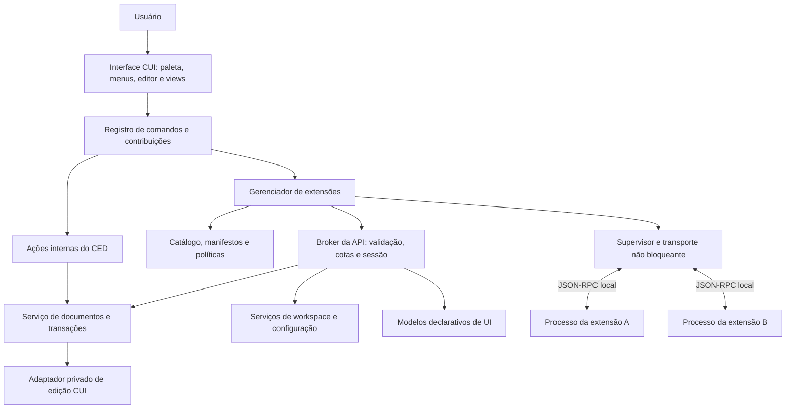
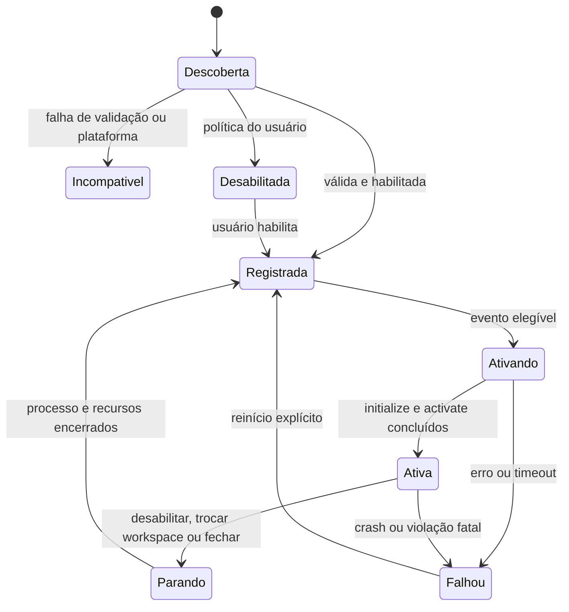

# Arquitetura de extensões do CED

**Status:** fases 0 e 1 implementadas como suporte experimental no CED 0.2.0 em desenvolvimento; fases posteriores continuam propostas. Veja o [perfil efetivamente implementado](extensions.md), que documenta métodos, limites e diferenças desta fatia inicial. A API 1.0 ainda não é estável.  
**Base analisada:** CED 0.1.0, commit `c7b97a1`, em 15/11/2026, incluindo o estado local dos adaptadores.  
**Escopo:** extensibilidade do editor desktop em C99/CUI, inicialmente em macOS e Linux.

**Navegação:** [decisão](#1-decisão-principal) · [componentes](#4-componentes-e-fronteiras) · [manifesto](#5-modelo-de-extensão-e-manifesto) · [instalação](#6-catálogo-instalação-e-configuração) · [ciclo de vida](#7-ativação-e-ciclo-de-vida) · [protocolo](#8-protocolo-ced-extension-api) · [edições](#9-documentos-revisões-e-transações-de-edição) · [API](#10-api-pública-inicial) · [segurança](#13-confiança-e-permissões) · [implementação](#18-plano-de-implementação).

O contrato de autoria para agentes e desenvolvedores está na [Extension Authoring Specification](extension-authoring-spec.md), em inglês. Ela detalha os formatos de mensagens e critérios de conformidade da API pretendida. Consulte também o [perfil experimental](extensions.md): o host anuncia apenas os métodos disponíveis em `hostMethods`, e não implementa ainda o contrato completo das fases seguintes. As evidências da seção 2 descrevem a base anterior à implementação.

## 1. Decisão principal

O CED deve oferecer dois tipos de extensão: **contribuições declarativas**, carregadas como dados, e **extensões executáveis**, iniciadas sob demanda em um processo separado por extensão e por janela. A comunicação com executáveis deve usar uma API própria do CED, versionada, sobre JSON-RPC 2.0 e transporte local por entrada/saída padrão.

O editor continua responsável pelos documentos, histórico de edição, salvamento, interface CUI e serviços de workspace. A extensão solicita operações e recebe cópias de dados; nunca recebe ponteiros do editor nem chama CUI diretamente. Comandos, menus e elementos visuais são registrados em pontos de contribuição controlados pelo CED.

Essa escolha evita uma ABI pública dependente das estruturas C e da revisão de CUI, permite extensões escritas em diferentes linguagens e separa falhas de processos. **Separação de processos não constitui uma sandbox:** um executável instalado tem os poderes do usuário no sistema operacional. As permissões propostas controlam a API do CED, não o acesso direto desse executável ao disco ou à rede.

O primeiro incremento deve permitir instalar uma extensão local, executar um comando pela paleta, ler o buffer ativo e aplicar uma edição com undo/redo. Não é necessário criar marketplace, runtime de scripts ou editor de interfaces para validar a arquitetura.

## 2. Situação atual e implicações

| Evidência no projeto | Implicação para a arquitetura |
| --- | --- |
| [CMakeLists.txt](../CMakeLists.txt) separa `ced_core` do executável `ced`; usa C99, Threads, cJSON e libvterm. | Os serviços de extensões podem ficar em bibliotecas internas sem depender de CUI. Não introduzir um runtime obrigatório no MVP. |
| [src/main.c](../src/main.c) concentra `Editor`, `EditorTab`, ciclo de frames, comandos, abertura, fechamento e troca de projeto. | Extrair pontos de integração gradualmente; não acrescentar toda a infraestrutura ao `main.c`. |
| A paleta usa um vetor estático de `cui_command` e despacho por índice em `switch`. Atalhos e botões chamam ações diretamente. | Criar um registro de comandos por ID e fazer paleta, atalhos e botões despacharem por ele. |
| [CedDocument](../src/workspace.h) contém caminho, texto, cópia salva, tamanho e convenção de fim de linha, sem identidade estável ou revisão pública. | Adicionar identidade e versão de documento antes de aceitar resultados assíncronos de extensões. |
| CUI altera o buffer no lugar. [src/editor_assist.c](../src/editor_assist.c) usa estruturas internas de CUI para aplicar completion com histórico. | Centralizar transações de edição e isolar esse detalhe num adaptador privado, testado contra a revisão de CUI utilizada. |
| [src/lsp.c](../src/lsp.c) já faz spawn, I/O não bloqueante, framing, sincronização e descarte de alguns resultados obsoletos. | Aproveitar a experiência e extrair transporte quando houver dois consumidores; manter os protocolos de LSP e extensões separados. |
| Busca e sincronização Git usam workers; [src/terminal.c](../src/terminal.c) gerencia um processo PTY. | Nenhum novo handler pode esperar por um processo ou trabalho demorado na thread da interface. |
| Salvamento verifica conflito com disco e preserva permissões e LF/CRLF em [src/workspace.c](../src/workspace.c). | Extensões devem usar os mesmos serviços, sem escrever buffers diretamente no disco. |
| [src/file_operations.c](../src/file_operations.c) usa operações relativas a descritores e evita seguir symlinks nas mutações. | Reutilizar essas garantias em futuras APIs de arquivos; uma simples comparação textual de caminhos não basta. |
| Preferências e recuperação ficam em `~/.ced`. Há um workspace por janela. | Manter essa convenção inicialmente e vincular os processos ao workspace atual. |
| Limites atuais: 32 abas, 2 MiB por arquivo de texto, 128 diagnósticos LSP por arquivo. | Preservar os limites do núcleo; negociar limites específicos da API sem fingir suporte ilimitado. |

O editor pode abrir arquivos fora do workspace. Portanto, “documento aberto” e “arquivo autorizado para uma extensão” precisam ser conceitos separados. Arquivos sem caminho também precisam de identidade, inclusive antes do primeiro salvamento.

## 3. Objetivos, limites e invariantes

### Objetivos

- Adicionar comandos, atalhos, menus e configurações sem recompilar CED.
- Permitir ferramentas que leiam buffers não salvos e proponham edições seguras.
- Acrescentar, em etapas posteriores, diagnósticos, temas, views e servidores de linguagem.
- Conter falhas, lentidão e consumo de filas de uma extensão sem interromper a edição.
- Manter um contrato público pequeno, documentado e verificável em macOS e Linux.
- Preservar o funcionamento de arquivos, Git, busca, Markdown, terminal e clangd sem extensões.

### Fora do primeiro ciclo

- Compatibilidade binária ou de API com extensões de VS Code.
- Plugins `.so`/`.dylib` carregados com `dlopen` no processo do editor.
- JavaScript, Lua, Python ou WebAssembly embutidos no CED.
- Webviews, HTML/JavaScript na interface, shaders ou callbacks de desenho externos.
- Marketplace, atualização automática, execução remota, Windows e multi-root.
- Hooks síncronos de tecla ou de salvamento, format-on-save e edição transacional de múltiplos arquivos.
- API genérica para executar shell, alterar Git ou escrever na sessão de terminal do usuário.

Uma extensão pode usar seu próprio runtime externo, mas deve declarar esse requisito. O CED não instala runtimes ou dependências automaticamente.

### Invariantes

1. Só a thread da interface confirma mutações de documentos e registros visuais.
2. Toda edição externa identifica a sessão, o workspace, o documento e a revisão esperada.
3. Uma edição confirmada equivale a uma ação de undo e não salva o arquivo automaticamente.
4. Nenhum ponteiro C, descritor de arquivo ou estado interno de CUI atravessa o protocolo.
5. Todo recurso dinâmico pertence à instância que o criou e é removido no encerramento dessa instância.
6. Falha de extensão não pode apagar buffers, invalidar recuperação ou bloquear indefinidamente o fechamento.
7. Descobrir um manifesto dentro de um repositório não autoriza executar código desse repositório.

## 4. Componentes e fronteiras



O **gerenciador** decide quais extensões existem, estão habilitadas e devem ser ativadas. O **supervisor** cuida de processos e conexão. O **broker** valida e despacha operações públicas. Os **serviços do editor** executam as operações sem saber se a origem foi um botão, um comando interno ou uma extensão.

### Organização proposta de código

Os caminhos abaixo são destinos de implementação, não arquivos existentes:

```text
src/
  commands.h/.c                 registro e execução de comandos por ID
  documents.h/.c                identidade, revisões e validação de transações
  editor_bridge.h/.c            adaptação de transações e seleção à CUI
  rpc_transport.h/.c            framing e filas, extraídos após segundo uso
  extensions/
    manifest.h/.c               parser e validação do manifesto
    catalog.h/.c                descoberta, compatibilidade e habilitação
    manager.h/.c                ativação, ownership e ciclo de vida
    process.h/.c                spawn, stderr, sinais e coleta de processos
    broker.h/.c                 handlers públicos e checagem de capacidades
    contributions.h/.c          descritores de comandos, menus e configurações
    extension_ui.h/.c           renderização CUI dos modelos, quando necessária
sdk/
  protocol/                    esquemas e fixtures do contrato público
  c/                           SDK C opcional, posterior à prova do protocolo
examples/extensions/
  uppercase-selection/         extensão executável de referência
tests/
  extension_manifest_test.c
  extension_protocol_test.c
  extension_lifecycle_test.c
  extension_edit_test.c
```

`documents`, `commands`, manifesto, catálogo, broker e transporte não devem incluir cabeçalhos CUI. `editor_bridge` e `extension_ui` pertencem à camada do executável. O broker usa uma pequena interface de serviços fornecida pelo aplicativo, sem conhecer a struct `Editor` ou criar um barramento genérico para todas as ações do projeto.

No CMake, usar inicialmente uma biblioteca interna `ced_extensions` ligada a `ced_core` e `ced_json`; os adaptadores de UI são compilados no alvo `ced`. Acrescentar `CED_ENABLE_EXTENSIONS`, com build e execução funcionais quando desativado. Não exportar símbolos do executável como API de plugins.

## 5. Modelo de extensão e manifesto

### Tipos

| Tipo | Conteúdo | Execução |
| --- | --- | --- |
| Declarativa | Dados de configuração e, numa fase posterior, temas e outros recursos suportados. | Sem processo; validação e carregamento pelo CED. |
| Executável | Manifesto, contribuições e um entrypoint por plataforma suportada. | Um processo iniciado por demanda, usando a API CED. |

Comandos de uma extensão executável podem aparecer na paleta antes da ativação. A execução do comando dispara a ativação e aguarda seu resultado de forma assíncrona. Contribuições declarativas não permitem expressões executáveis.

### Exemplo de `ced-extension.json`

```json
{
  "manifestVersion": 1,
  "id": "example.text-tools",
  "name": "Text Tools",
  "version": "0.1.0",
  "description": "Transformações explícitas no buffer ativo.",
  "license": "MIT",
  "ced": { "minVersion": "0.2.0", "apiMajor": 1 },
  "kind": "executable",
  "entrypoints": {
    "darwin-arm64": "bin/darwin-arm64/text-tools",
    "darwin-x86_64": "bin/darwin-x86_64/text-tools",
    "linux-x86_64": "bin/linux-x86_64/text-tools"
  },
  "activationEvents": ["onCommand:example.text-tools.uppercase"],
  "capabilities": ["documents.read", "documents.edit"],
  "untrustedWorkspaces": false,
  "contributes": {
    "commands": [
      {
        "id": "example.text-tools.uppercase",
        "title": "Converter seleção para maiúsculas",
        "category": "Texto",
        "enableWhen": { "editorTextFocus": true, "hasSelection": true }
      }
    ],
    "keybindings": [
      {
        "command": "example.text-tools.uppercase",
        "key": "Mod+Alt+U",
        "when": { "editorTextFocus": true, "hasSelection": true }
      }
    ],
    "menus": [
      {
        "location": "editor.context",
        "command": "example.text-tools.uppercase",
        "group": "transform",
        "order": 10
      }
    ],
    "configuration": [
      {
        "key": "example.text-tools.locale",
        "type": "string",
        "default": "pt-BR",
        "scope": "user",
        "description": "Localidade usada nas transformações."
      }
    ]
  }
}
```

`0.2.0` é um mínimo ilustrativo para uma futura versão do CED com extensões; não indica disponibilidade no CED 0.1.0. A primeira versão implementada deve ajustar esse número.

### Regras de validação

- `manifestVersion`, `id`, `name`, `version`, `ced` e `kind` são obrigatórios. Versões usam `MAJOR.MINOR.PATCH`; o MVP não aceita intervalos npm, prereleases ou build metadata.
- `id` segue `publisher.name`, com cada parte formada por letras ASCII minúsculas, números e hífens; até 128 bytes no total. O namespace `ced` é reservado. IDs de comandos e chaves de configuração começam com `<id>.`.
- `executable` exige `entrypoints` e ao menos um evento de ativação. `declarative` não aceita entrypoints, ativação ou capacidades de execução; no MVP, aceita apenas configuração. Temas só serão aceitos quando sua contribuição existir.
- `requirements` é um campo opcional conhecido: lista de objetos com `name` e `minVersion` string, apenas para informar runtimes/ferramentas externos necessários. A instalação apresenta esses requisitos; não os baixa, executa nem considera sua presença comprovada pelo manifesto. Falta de interpretador ou ferramenta resulta em erro de ativação identificável.
- O entrypoint é um caminho relativo ao pacote, regular e executável. Recusar caminho absoluto, `..`, symlink ou destino fora do pacote. Usar caminho absoluto validado no spawn, sem resolução implícita por `PATH` ou shell.
- Apenas capacidades, eventos e pontos de contribuição conhecidos são aceitos. Um manifesto que exija recurso futuro é incompatível, em vez de parcialmente habilitado.
- Campos desconhecidos na versão 1 são erro, exceto um objeto opcional `metadata`, sem efeito executável. Campos opcionais novos devem ser acompanhados por `ced.minVersion` adequado.
- Limites iniciais: manifesto de 256 KiB, profundidade JSON de 32, 100 comandos, 100 atalhos, 100 itens de menu, 100 configurações e strings de apresentação de até 512 bytes. Recusar chaves duplicadas.
- `enableWhen` e `when` são objetos de condições combinadas por AND. As únicas chaves iniciais são `editorTextFocus`, `hasSelection`, `hasDocument`, `workspaceTrusted` e `languageId`; valores booleanos, exceto `languageId`, que usa string. Não há `eval` ou DSL de expressões.
- Uma condição visual nunca substitui validação no handler: o estado pode mudar entre mostrar um comando e executá-lo.

IDs duplicados, tipos incorretos, arquivo incompatível e plataforma sem entrypoint produzem diagnóstico no catálogo. Não derrubam o editor nem iniciam o processo.

## 6. Catálogo, instalação e configuração

### Armazenamento

```text
~/.ced/
  settings.conf                            preferências atuais, preservadas
  extensions.json                          versão ativa, habilitação e decisões do usuário
  extension-settings.json                  configurações globais com namespace
  extensions/<id>/<version>/               pacotes instalados e imutáveis durante uso
  extension-data/<id>/global.json           estado JSON privado da extensão
  extension-data/<id>/workspaces/<key>.json estado por workspace canônico
  logs/extensions/<session>/<id>.log        logs locais com rotação

<workspace>/.ced/
  extension-settings.json                  valores permitidos para o projeto
  extensions.json                          recomendações de IDs, sem execução automática
```

O identificador de workspace deriva do caminho canônico, com verificação do caminho original nos metadados para evitar colisões de chave. Confiança, habilitação e concessões ficam no perfil do usuário; nunca são lidas como autorização do repositório. Estado por workspace deve ter exclusão mútua entre instâncias ou retornar conflito, sem sobrescrever silenciosamente a gravação de outra janela.

### Instalação local no MVP

1. O usuário seleciona uma pasta de pacote pelo comando **Instalar extensão local**.
2. O CED valida manifesto, arquivos, permissões de execução, versão e plataforma, sem rodar scripts.
3. A interface mostra ID, versão, origem, capacidades solicitadas e que executáveis têm acesso ao sistema como o usuário.
4. Após a ação explícita de instalação, copiar para uma pasta temporária no perfil, validar a cópia e promovê-la por rename no mesmo filesystem. Recusar links, arquivos especiais, caminhos escapando do pacote e pacotes acima de 64 MiB ou 2.000 arquivos.
5. Registrar a versão ativa por escrita atômica. Somente o registro selecionado pode ser ativado.

Atualizações são manuais, repetem validação e revisão de capacidades e entram em vigor após parar a instância antiga. Manter a versão anterior para rollback manual; nunca substituir arquivos usados por um processo ativo. Recusar reinstalação da mesma versão com conteúdo diferente. Um hash de conteúdo identifica a instalação, mas não autentica o autor. Assinatura e distribuição por registro ficam para outra fase.

Só uma versão por ID fica ativa em uma janela. O MVP não admite dependências entre extensões: cada pacote entrega seus recursos e não pode instalar outros pacotes. Uma extensão não executa comandos pertencentes a outra.

**Desabilitar** interrompe a instância e retira suas contribuições. **Desinstalar** também remove o pacote, depois que nenhum processo local estiver usando aquela instalação; estado do usuário é preservado até uma ação explícita de limpeza. Falhas de instalação deixam a versão ativa anterior intacta.

### Configuração e estado

A precedência é `default do manifesto < configuração do usuário < configuração do workspace`. Somente chaves declaradas com `scope: "workspace"` aceitam sobrescrita pelo projeto; `scope: "user"` não aceita. Tipos iniciais: string, booleano e número finito, com validação de limites/enumeração quando declarados. Uma chave inválida usa o último valor válido ou o default e gera diagnóstico.

Configuração não determina entrypoint, autorização, caminho de runtime ou argumentos de shell. Configurações de projeto são dados não confiáveis. Leitura usa o namespace da própria extensão; alterações de configuração no MVP são feitas pela interface/arquivo do usuário, sem API para alterar preferências de outras extensões. Estado persistente é outro serviço, com limite de 256 KiB por escopo e gravação atômica; não substitui armazenamento de segredos.

## 7. Ativação e ciclo de vida

### Estados



“Registrada” significa que descritores estáticos existem, não que há processo em execução. Um processo é criado por extensão ativa e por janela, mesmo para extensões instaladas globalmente. O workspace atual é a unidade de execução; trocar de projeto encerra as instâncias antigas e inicia novas apenas se necessário.

### Eventos de ativação

| Evento | Semântica |
| --- | --- |
| `onCommand:<id>` | Primeiro disparo de um comando declarado pela própria extensão. É o único evento exigido no MVP. |
| `onLanguage:<id>` | Fase posterior: documento autorizado daquela linguagem é aberto ou já estava aberto após inicialização. |
| `onView:<id>` | Fase posterior: usuário abre uma view declarada pela extensão. |
| `onStartupFinished` | Fase posterior, opt-in: após primeiro frame e restauração, nunca no caminho crítico da abertura da janela. |

Eventos simultâneos geram uma única ativação. Invocações pendentes mantêm seu contexto de origem e prazo; um comando originado no documento A não passa a editar B porque a seleção mudou durante a inicialização. Para o MVP, permitir uma invocação em execução por extensão e retornar `Busy` nas demais, sem acumular uma fila invisível de comandos.

### Handshake

1. Gerenciador verifica confiança do workspace, habilitação, entrypoint, capacidades concedidas e orçamento de processos.
2. Supervisor inicia o executável em grupo de processos próprio. `cwd` é a pasta do pacote; o workspace é informado no handshake. `stdin/stdout` são exclusivos do protocolo e `stderr` é drenado separadamente.
3. CED envia `ced/initialize`: versões de protocolo oferecidas, versão do aplicativo, identidade esperada da extensão, sessão, workspace, capacidades concedidas, limites e `hostMethods` com os serviços efetivamente implementados.
4. A extensão responde com sua identidade, versão, `apiVersion` escolhida e `requiredHostMethods`. ID/versão devem coincidir com a instalação e os métodos exigidos precisam estar disponíveis; a identidade efetiva vem da conexão criada pelo CED, não da resposta. Os formatos exatos estão na spec de autoria.
5. CED envia `ced/activate` com o motivo. Após a resposta de sucesso, a instância fica ativa e pode usar os métodos concedidos. Chamadas de serviço antes disso recebem `NotActive`.
6. A invocação original é enviada como `commands/invoke`. Se a ativação falhar, responder ao usuário com erro e permitir nova tentativa explícita.

`ced/activate` apenas instala handlers locais; a API do editor só fica disponível após a resposta. Isso evita deadlock e chamadas parcialmente inicializadas. Não executar novamente `initialize` numa conexão já inicializada.

### Encerramento e falha

Desabilitação, troca de workspace e fechamento primeiro impedem novas invocações e invalidam mutações pendentes. CED envia `ced/deactivate`, espera no máximo 500 ms sem bloquear frames e fecha a conexão. Se necessário, envia `SIGTERM` ao grupo e, após mais 500 ms, `SIGKILL`, coletando o filho direto com `waitpid` e fechando todos os descritores.

Callbacks de encerramento são best effort: não podem vetar fechamento nem editar documentos. No fechamento da janela, recuperação dos buffers acontece independentemente deles. Na troca de workspace, invalidar a geração anterior antes de abrir novos documentos; mensagens antigas são descartadas mesmo que o processo demore a terminar.

Em crash ou timeout fatal: cancelar requisições, liberar recursos, limpar diagnósticos/status/views da instância e indicar a falha na paleta de gerenciamento. Descritores estáticos do comando permanecem para permitir reinício explícito; ao desabilitar, também desaparecem. Não reiniciar automaticamente nem repetir comandos com efeitos. Se a conexão cair depois de uma edição ter sido confirmada, o buffer permanece editado; o log identifica o commit, sem replay automático.

Um grupo de processos facilita limpeza, mas não contém código hostil que se desanexe. O modelo de confiança continua sendo execução local de código autorizado pelo usuário.

## 8. Protocolo CED Extension API

### Transporte e contrato básico

Usar mensagens JSON-RPC 2.0 bidirecionais com `params` em objeto, requisições com IDs string e notificações sem ID. Respostas contêm `result` ou `error`, nunca ambos. Notificações não recebem resposta, conforme a [especificação JSON-RPC 2.0](https://www.jsonrpc.org/specification).

O enquadramento local é uma decisão do CED, compatível com o padrão já usado no cliente LSP do projeto:

```text
Content-Length: <quantidade de bytes UTF-8 do corpo>\r\n
\r\n
<objeto JSON-RPC sem quebra de linha adicional obrigatória>
```

Regras do perfil CED:

- Um objeto por frame, corpo UTF-8 válido, sem BOM. Não aceitar batch, parâmetros posicionais, IDs numéricos ou IDs nulos em requisições. Para erros sem ID recuperável, a resposta usa `id: null`.
- Cabeçalho ASCII de até 1 KiB, um único `Content-Length` decimal positivo, sem overflow, e separador `\r\n\r\n`. Cabeçalhos duplicados, framing inválido e comprimento acima da cota encerram a conexão; não tentar adivinhar a próxima mensagem.
- Tratar leituras fragmentadas, múltiplos frames por leitura, escritas parciais, `EINTR`, `EAGAIN`, EOF e `EPIPE`, sem deixar `SIGPIPE` encerrar CED.
- Emissor CED usa IDs `ced:<contador>`; extensão usa `ext:<contador>`. IDs não são reutilizados na conexão. Respostas podem chegar fora de ordem.
- Não usar socket de rede, arquivo de rendezvous ou porta acessível por outros clientes. A posse do canal herdado liga a conexão à instância criada pelo supervisor.
- Métodos desconhecidos recebem `-32601`; parâmetros inválidos, `-32602`; erros internos, `-32603`; JSON inválido, `-32700`; objeto RPC inválido, `-32600`. Arrays/batch são inválidos neste perfil.
- Métodos conhecidos, mas não negociados, recebem `UnsupportedCapability`. Violações em notificações são registradas; repetição abusiva encerra a instância.
- Após o handshake, toda chamada/notificação inclui `params.context`. A resposta é vinculada ao contexto capturado pela requisição pendente, mesmo sem repeti-lo no resultado.

### Contexto e negociação

```json
{
  "sessionId": "session-7",
  "workspaceId": "workspace-3",
  "generation": 2
}
```

`sessionId` muda a cada processo iniciado; `workspaceId` identifica a abertura atual do workspace na janela; `generation` é um inteiro incrementado na troca de projeto. São identificadores opacos, não caminhos nem credenciais. Toda mensagem usa o contexto fornecido pelo CED, validado junto à identidade da conexão. Respostas tardias de requisições canceladas são descartadas.

`manifestVersion`, versão do pacote, versão do CED e versão da API são independentes. A primeira API será `1.0`; a extensão declara o major no manifesto e escolhe uma versão exata dentre as oferecidas em `initialize`. O broker usa apenas capacidades disponíveis nessa versão e concedidas à instância. Sem interseção de versões, a extensão falha antes de ativar.

Adicionar método ou campo opcional pode incrementar minor; mudar semântica, remover campo ou tornar campo obrigatório exige major. SDKs devem ignorar campos opcionais desconhecidos nas mensagens, mas validar campos obrigatórios e tipos. Manifestos seguem a política mais estrita de validação descrita na seção 5. Não prometer uma janela de suporte a majors antigos antes de existir experiência real de manutenção.

### Erros de domínio

Os códigos abaixo pertencem à faixa de erros de servidor definida pela implementação; `error.data.reason` é a chave estável para tratamento programático. Mensagens são apenas apresentação.

| Código | `reason` | Situação |
| --- | --- | --- |
| `-32001` | `PermissionDenied` | Capacidade ou documento não autorizado. |
| `-32002` | `StaleDocument` | Revisão de buffer diferente da esperada. |
| `-32003` | `InvalidContext` | Sessão, workspace ou geração inválidos. |
| `-32004` | `Cancelled` | Operação cancelada antes da confirmação. |
| `-32005` | `ResourceLimit` | Mensagem, fila, documento ou recurso excede cota. |
| `-32006` | `Busy` | Instância/serviço ocupado. |
| `-32007` | `NotActive` | Operação fora do estado permitido. |
| `-32008` | `UnsupportedCapability` | Recurso conhecido não negociado. |
| `-32009` | `Timeout` | Prazo esgotado antes da confirmação. |
| `-32010` | `Conflict` | Conflito de configuração/estado ou destino. |
| `-32011` | `Unavailable` | Documento fechado, processo encerrado ou serviço indisponível. |
| `-32012` | `StaleEditorContext` | Seleção ou editor de origem mudou desde a invocação. |

Não expor ponteiros, dumps de buffer ou variáveis de ambiente em mensagens de erro.

### Cancelamento e prazos

`ced/cancel` é uma notificação com `context` e `requestId`. Cancelamento é cooperativo para trabalho da extensão; no CED, invalida operações ainda não confirmadas. O lado que recebeu uma requisição cancelada deve concluir com `Cancelled` quando ainda puder responder. Uma operação já confirmada não é revertida: sua resposta de sucesso continua válida. Timeout local remove a espera, descarta respostas tardias e nunca dispara retry automático de uma mutação.

Prazos iniciais: 3 s para initialize, 2 s para activate, 5 s para invocação de comando, 500 ms para deactivate. Pedidos simples ao broker têm prazo de 1 s. Uma extensão com tarefa demorada deve responder ao comando e trabalhar em background, consultando o documento novamente antes de propor edição; não recebe um prazo ilimitado de escrita.

## 9. Documentos, revisões e transações de edição

### Identidade e representação

O serviço de documentos introduz um `documentId` opaco, não reutilizado na sessão, e `version` inteira monotônica. Caminho e índice de aba nunca são identidade. Reordenar abas não muda o ID; fechar e reabrir cria outro. Rename e Save As mantêm o ID e emitem mudança de metadados.

Todo texto exposto na API é UTF-8 válido, com LF e sem NUL; a convenção LF/CRLF de disco é metadado. Como o leitor atual não estabelece um contrato completo de validação UTF-8, o primeiro incremento deve validar antes de expor texto à API. Um arquivo legado inválido pode continuar aberto segundo o comportamento existente, mas a API informa `textAccessible: false` e rejeita leitura/edição até conversão explícita; não converter silenciosamente conteúdo.

Ranges usam offsets em **bytes UTF-8**, zero-based e fim exclusivo: `[start, end)`. Limites precisam cair entre codepoints, jamais no meio de um byte multibyte. A API não usa coluna visual nem unidades UTF-16; os adaptadores LSP continuam convertendo entre seus próprios tipos. `version` e contadores numéricos não excedem `2^53 - 1`; renovar identidade/sessão antes de overflow.

`version` aumenta a cada alteração efetiva de texto: digitação, paste, completion, undo, redo e edição de extensão. Salvar sem alterar texto e renomear não a incrementam. A integração deve registrar mudanças tanto após `cui_code_editor_result.changed` quanto após edições programáticas, que hoje seguem outro caminho. Atualizar também `CedDocument.length`; não tratá-lo como revisão.

### Snapshot e foco

`documents/get` devolve texto e revisão capturados juntos. `editor/getContext` devolve documento ativo, seleção `[anchor, cursor]` em bytes e `selectionVersion`; esta aumenta quando o editor de origem, documento ou seleção mudam. Abrir a paleta ou um menu sobre esse editor não altera a revisão de seleção por si só. Um comando recebe esse contexto no instante da invocação, e a extensão escolhe se sua ação depende dele.

Para uma transformação de seleção, `documents/applyEdits` inclui `expectedSelectionVersion`: se o usuário mover o cursor durante o cálculo, recusar a operação com `StaleEditorContext`. Uma ferramenta explicitamente destinada a um documento específico pode omitir essa exigência e editar esse documento ainda aberto, mesmo que outra aba esteja ativa, respeitando sua revisão.

### Transação de um documento no MVP

1. Validar estado da instância, contexto e `documents.edit`, além do acesso ao documento.
2. Confirmar que o documento ainda existe, que sua revisão é a esperada e, quando pedido, que a seleção ainda é a mesma.
3. Validar a lista inteira: offsets inteiros, ranges válidos, UTF-8 válido, ausência de NUL, texto com LF e ranges não sobrepostos. Rejeitar inserções ambíguas na mesma posição.
4. Calcular tamanho final com aritmética verificada e exigir que caiba em `CED_TEXT_CAP`, incluindo terminador NUL.
5. Preparar todas as alocações e dados de undo antes de mudar o buffer. Falha de memória retorna erro sem alteração.
6. Em um ponto seguro do frame, verificar novamente revisão/contexto e confirmar uma única transação no adaptador CUI. Aplicar ranges do fim para o início; offsets referem-se ao snapshot original.
7. Incrementar revisão uma vez, atualizar seleção conforme política explícita, invalidar assistências obsoletas, marcar sincronização LSP pendente e publicar o evento de mudança. Retornar a nova revisão.

Uma lista vazia ou que não altere o texto retorna sucesso com a revisão atual e sem criar undo/evento. A transação nunca salva no disco. Dirty state continua derivado do buffer e da cópia salva; uma edição que restaure exatamente o conteúdo salvo pode deixar o documento limpo.

### Exemplo de pedido de edição

```json
{
  "jsonrpc": "2.0",
  "id": "ext:12",
  "method": "documents/applyEdits",
  "params": {
    "context": {
      "sessionId": "session-7",
      "workspaceId": "workspace-3",
      "generation": 2
    },
    "documentId": "doc-18",
    "expectedVersion": 41,
    "expectedSelectionVersion": 9,
    "label": "Converter seleção para maiúsculas",
    "edits": [{ "start": 10, "end": 15, "text": "TEXTO" }],
    "selection": { "anchor": 10, "cursor": 15 }
  }
}
```

`selection` é opcional e usa offsets no texto final. Sem ela, o CED transforma a seleção existente pelos deltas das edições: posições dentro de um range substituído vão para o fim da substituição; posições seguintes recebem o deslocamento acumulado; uma inserção exatamente na posição move a posição para depois do texto inserido. A mesma regra vale independentemente da direção anchor/cursor.

Sucesso:

```json
{
  "jsonrpc": "2.0",
  "id": "ext:12",
  "result": { "documentId": "doc-18", "version": 42, "changed": true }
}
```

Se o usuário digitar antes da confirmação, retornar `StaleDocument` e a revisão atual em `error.data.currentVersion`. A extensão pode pedir outro snapshot; não reaplicar automaticamente offsets antigos. Com duas extensões editando a versão 41, a primeira confirmação produz 42 e a segunda falha.

### Ponte com CUI

`editor_bridge` deve aceitar uma transação abstrata, sem expor `CedCompletion`. Reutilizar a experiência de `ced_editor_replace`, mas substituir o acoplamento ao modelo de completion e garantir um único checkpoint de undo para toda a lista. O adaptador precisa suportar abas inativas e seleção de forma consistente; na ausência dessa garantia, retornar `Unavailable`, nunca modificar o texto por fora do histórico.

Os buffers e strings usados pelo renderer precisam continuar vivos até o frame terminar. Processar mutações e trocas de modelos no começo do frame, antes de desenhar; liberar versões antigas apenas quando não forem mais referenciadas. É a mesma preocupação já registrada em `frame()` para ações de arquivos e fontes de diff.

API pública de transações em CUI seria a solução preferida no longo prazo. Enquanto depender de internos, manter essa dependência restrita ao adaptador e coberta por testes. Multi-document edits, mudanças estruturais em disco e rollback entre arquivos exigem outro contrato; não serão simulados como “atômicos” no MVP.

## 10. API pública inicial

Todos os métodos abaixo são propostas da API `1.0`. Os serviços são assíncronos no cliente, mesmo que alguns handlers do CED concluam no mesmo frame. Strings, listas e números são validados antes do despacho.

| Método | Direção | Contrato resumido | Capacidade |
| --- | --- | --- | --- |
| `ced/initialize` | CED → extensão | Negocia identidade, versão, contexto, limites e capacidades. | Lifecycle |
| `ced/activate` | CED → extensão | Recebe motivo e conclui preparação local. | Lifecycle |
| `ced/deactivate` | CED → extensão | Encerramento best effort; nenhuma mutação nova permitida. | Lifecycle |
| `ced/cancel` | Ambos, notificação | Cancela requisição identificada por `requestId`. | Lifecycle |
| `commands/invoke` | CED → extensão | `commandId`, `arguments` JSON limitados a 64 KiB e contexto de editor capturado; resultado JSON até 64 KiB. | Comando declarado |
| `editor/getContext` | Extensão → CED | Documento ativo autorizado, seleção e `selectionVersion`; sem texto. Sem acesso, retorna ausência de documento. | `documents.read` |
| `documents/list` | Extensão → CED | Metadados dos documentos autorizados, sem texto: ID, URI opcional, linguagem, revisão, dirty e `textAccessible`. | `documents.read` |
| `documents/get` | Extensão → CED | Recebe `documentId`; devolve metadados e snapshot `text` da mesma revisão. | `documents.read` |
| `documents/applyEdits` | Extensão → CED | ID, revisão esperada, label, lista de edições, seleção opcional; retorna revisão e `changed`. | `documents.edit` |
| `events/subscribe` | Extensão → CED | Recebe nomes de eventos permitidos; retorna `subscriptionId`. | Conforme evento |
| `events/unsubscribe` | Extensão → CED | Libera assinatura da própria instância; operação idempotente. | Ownership |
| `events/publish` | CED → extensão, notificação | Entrega `subscriptionId`, `sequence`, nome e metadados do evento. | Conforme assinatura |
| `configuration/get` | Extensão → CED | Valores efetivos e revisão da configuração do próprio namespace. | Básica |
| `state/get` | Extensão → CED | Estado JSON e revisão no escopo `global` ou `workspace`. | Básica |
| `state/set` | Extensão → CED | Substitui estado do próprio escopo com `expectedRevision`; retorna nova revisão. | Básica |
| `window/showMessage` | Extensão → CED | Texto simples e nível `info`, `warning` ou `error`, identificados pelo nome da extensão; sem HTML ou ações arbitrárias. | Básica |
| `log/write` | Extensão → CED, notificação | Nível e mensagem estruturada, sujeitos a cota e remoção de controles de terminal. | Básica |

“Básica” significa disponível a qualquer instância executável ativa, sem acesso a namespaces alheios. `documents.edit` depende de `documents.read`; o manifesto deve declarar ambas. Não existe método `commands/execute` genérico na primeira API: isso evitará que uma capacidade aparentemente simples contorne as políticas de Git, terminal ou arquivos.

Métodos de lifecycle não exigem `params.context` em `initialize`, pois é quando ele é entregue; os demais usam contexto normalmente. Nenhum método de abertura, salvamento, exclusão de arquivos, processo ou rede será exposto no primeiro ciclo.

### Eventos e sincronização

Eventos iniciais: `document.opened`, `document.changed`, `document.saved`, `document.closed`, `document.metadataChanged`, `editor.contextChanged` e `configuration.changed`. Eventos de documento exigem `documents.read` e seguem o mesmo filtro de acesso das consultas.

- `document.changed` carrega ID e revisão, **sem texto completo**. A extensão pede snapshot somente quando precisa. Isso evita replicar até 32 buffers para cada processo por tecla.
- `document.metadataChanged` informa alterações de URI, linguagem e acessibilidade sem fingir mudança de texto.
- A assinatura começa a valer em um limite definido do frame. A resposta de `subscribe` é enviada antes das notificações dessa assinatura; depois, o cliente consulta `documents/list` para obter o estado inicial.
- `sequence` cresce por assinatura. É ordem de entrega, não histórico de todas as teclas. Mudanças sucessivas do mesmo documento/contexto podem ser combinadas na fila, mantendo o último estado; `opened`, `closed` e `saved` preservam sua ordem.
- Uma revisão saltar de 41 para 47 é permitido; o consumidor deve obter snapshot, não inferir deltas. Se um evento essencial não couber na fila, encerrar a conexão como falha de recurso e exigir ressincronização numa nova sessão.
- Eventos não são hooks com veto. Uma extensão não pode atrasar ou impedir o salvamento atual.

## 11. Integração de comandos e interface

### Registro único de comandos

Cada comando recebe ID estável, título, categoria, condição de disponibilidade e handler interno ou proprietário externo. Migrar a paleta estática para esse registro sem alterar comportamento dos comandos existentes. Reservar nomes como `ced.file.save`, `ced.workspace.open` e `ced.terminal.toggle` para ações internas.

A paleta CUI ainda pode trabalhar com um vetor e índice; o adaptador cria um snapshot por frame e mantém o mapeamento índice → ID. Um registro mutável não deve invalidar ponteiros de títulos enquanto a paleta usa esse snapshot. Na paleta e nos menus, condições como `editorTextFocus` são avaliadas contra o contexto de origem capturado antes de abrir o overlay; o foco temporário no campo de busca não desabilita todos os comandos de texto. Ao executar, revalidar que esse contexto ainda existe e está autorizado.

Atalhos usam o mesmo despacho. Conflitos são resolvidos por configuração explícita do usuário, depois atalhos internos, depois extensões em ordem de ID; registrar o conflito e permitir remapeamento. O MVP aceita uma combinação por atalho, sem chords. Não capturar digitação, teclas de edição essenciais ou atalhos quando terminal, modal ou outro contexto incompatível estiver focado. Condições são reavaliadas na execução.

Menus iniciais: `editor.context` e `explorer.context`. Um clique no explorer fornece um alvo de workspace validado, sem conceder leitura de arquivo. A ordem usa grupo, número e ID como desempate. IDs e ícones vêm de uma lista permitida; nunca aceitar código, ponteiros ou nomes de símbolos CUI do manifesto.

### UI adicional, após o MVP

Oferecer modelos pequenos, renderizados pelo CED:

| Contribuição | Modelo | Política |
| --- | --- | --- |
| Status bar | ID local, texto simples, tooltip e comando próprio opcional. | Limite de itens e atualização; falha limpa tudo. |
| Output | Canal de texto append-only, sem interpretar ANSI. | Buffer circular e limite de bytes. |
| Tree view | Nós com ID, label, ícone permitido, filhos e comando próprio opcional. | Carregamento assíncrono e número máximo de nós. |
| Diagnostics | Documento, revisão, range, severidade e mensagem. | Coleção por proprietário e descarte por revisão. |
| Theme | Arquivo de tokens semânticos documentados. | Dados validados; nenhum endereço ou enum interno de CUI. |

Esses modelos requerem novas capacidades e negociação; não estão automaticamente incluídos na API inicial. A extensão publica um modelo persistente e recebe eventos do usuário, sem participar de cada frame. Substituir snapshots no ponto seguro do frame e coalescer atualizações rápidas. Não criar uma linguagem completa de layout antes de aparecer uma necessidade concreta.

## 12. Extensões de linguagem e serviços existentes

LSP permanece um protocolo separado para inteligência de linguagem, como descreve a [documentação oficial do LSP](https://microsoft.github.io/language-server-protocol/). A API de extensões não deve copiar toda a especificação nem substituir `CedLsp` imediatamente.

Evolução proposta:

1. Manter clangd e `CED_CLANGD` funcionando como hoje durante o MVP.
2. Extrair seleção de linguagem e configuração de servidor do `main.c`, preservando completion, hover, definição e diagnostics existentes.
3. Adicionar contribuição `languageServers`: linguagens, entrypoint instalado ou caminho de ferramenta escolhido pelo usuário, argumentos estáticos e requisitos. Caminhos e argumentos executáveis não vêm de configuração não confiável de projeto.
4. Evoluir `CedLsp` para sessões por servidor/workspace, registro de documentos e roteamento por linguagem. O código atual possui uma sessão e limites próprios; um campo no manifesto sozinho não habilita múltiplos servidores.
5. Definir seleção explícita quando dois servidores reivindicam uma linguagem, preferindo a escolha do usuário e preservando clangd como default de C/C++.

Diagnostics de extensões e de LSP devem ter ownership distinto; fechar/reiniciar um provider remove apenas seus dados. Marcas e Problems precisam respeitar cotas agregadas e informar truncamento. Novos recursos como formatting, rename e code actions deverão usar o serviço comum de transações, sem caminho alternativo para modificar texto.

Git, busca e terminal continuam serviços internos. Uma futura API de tarefas deve executar processos próprios, com argumentos vetoriais e output separado; nunca inserir comandos silenciosamente na sessão interativa que o usuário mantém aberta.

## 13. Confiança e permissões

### Duas decisões distintas

**Instalar/habilitar código local** é autorizar um executável do usuário. **Conceder capacidades da API** determina o que o broker entrega e quais alterações ele aceita. A segunda decisão não consegue restringir os syscalls do processo autorizado pela primeira.

No MVP, extensões executáveis não iniciam em workspaces ainda não confiáveis. A confiança é concedida explicitamente ao caminho canônico pelo usuário e fica fora do repositório. Contribuições declarativas validadas continuam disponíveis. `untrustedWorkspaces: false` é obrigatório para executáveis na versão inicial; aceitar `true` só quando existir um modelo seguro adicional. Confiar numa pasta não instala extensões recomendadas por ela.

### Escopo de documentos

- Por padrão, `documents.read/edit` cobre somente documentos salvos dentro do workspace canônico autorizado.
- Buffers sem caminho e documentos abertos fora dessa raiz exigem uma concessão explícita por documento no gerenciador; nenhuma extensão ganha acesso porque outra abriu uma aba.
- Conteúdo, URI e eventos de documentos sem acesso são filtrados. A invocação de comando não inclui seus metadados; a UI pode oferecer a ação de conceder acesso antes de invocar.
- Save As/rename reavalia o escopo, cancela operações pendentes incompatíveis e encerra a exposição de documentos que saiam da raiz. Antes de retirar acesso, entregar um `document.closed` sintético sem novo caminho e invalidar handles; ao conceder, publicar `document.opened`.
- O broker verifica permissões no pedido e na confirmação. Revogação encerra/recria a instância e suas assinaturas, sem alegar que apaga cópias já recebidas pelo processo.

### Execução e arquivos

O spawn usa `argv` vetorial, ambiente reduzido e descritores não necessários fechados. Preservar apenas variáveis explicitamente documentadas e necessárias, como locale, diretório pessoal e diretórios temporários; variáveis de credenciais e tokens do processo CED não são repassadas automaticamente. Isso reduz exposição acidental, mas não impede o executável de ler o perfil ou buscar credenciais por conta própria.

Não executar hooks de instalação, `sh -c`, comandos vindos de Markdown ou entrypoints de dentro do workspace automaticamente. No futuro, leituras/escritas brokeradas em arquivos devem partir de descritores de diretório autorizados, validar cada componente e evitar seguir symlinks e corridas de substituição, seguindo o padrão de `file_operations.c`. `realpath` isolado não resolve a corrida entre checar e usar.

Sandbox real exigiria um projeto adicional de confinamento por plataforma ou um runtime com capacidades. Não prometer confinamento portátil para executáveis nativos apenas com manifestos, variáveis de ambiente, grupos de processos ou limites de API.

## 14. Concorrência, recursos e desempenho

### Integração ao frame

O primeiro incremento pode seguir o modelo de polling já utilizado para LSP: drenar I/O não bloqueante com orçamento, validar mensagens, enfileirar intenções e aplicar ações no início do frame. Usar `cui_request_wakeup` enquanto houver processo ou trabalho pendente. Round-robin entre instâncias impede uma extensão ruidosa de monopolizar o ciclo.

Parsing de uma mensagem grande também consome tempo: não basta tornar `read` não bloqueante. Mensagens pequenas podem ser tratadas no frame; corpos acima de 64 KiB devem ser validados/parseados em worker com filas limitadas. O worker recebe bytes e produz dados próprios imutáveis; não acessa buffers vivos, `Editor` ou CUI. O commit continua na thread de UI.

Serialização de snapshots grandes também deve sair do frame após uma cópia consistente; checar cota antes da cópia. I/O de estado e instalação, assim como espera de término de processos, não ocorre de forma bloqueante na thread de UI. Resultados de workers sempre voltam com sessão/geração e são descartados se a origem deixou de existir.

### Limites iniciais propostos

São defaults a validar com medições, não resultados já obtidos:

| Recurso | Limite/política inicial |
| --- | --- |
| Extensões executáveis ativas | 4 por janela; exceder retorna `ResourceLimit`, sem matar outra extensão. |
| Frame RPC | 16 MiB de corpo, header até 1 KiB; profundidade de mensagem até 64 e rejeição de chaves duplicadas. |
| Filas por instância | Até 16 MiB de entrada e 16 MiB de saída serializada; até 64 requisições pendentes, com memória alocada sob demanda. |
| Memória de transporte agregada | 64 MiB por janela, contabilizando bytes retidos e reservas antes de alocar. |
| Estruturas parseadas e snapshots | Orçamento agregado separado de 64 MiB; contabilizar alocações reais, não apenas tamanho do JSON. |
| Edições | Até 1.000 ranges por transação e tamanho final dentro do limite atual de 2 MiB. |
| Assinaturas | Até 32 por instância. |
| Processamento no frame | Meta de até 2 ms de despacho de extensões por frame, adiando trabalho restante; nenhum handler de trabalho pesado no frame. |
| Notificações ao usuário | Até 5 em 10 s por instância; excedentes agrupados. |
| Logs | Até 1 MiB por arquivo, 3 arquivos por instância; truncar mensagens acima de 8 KiB e limitar a 64 KiB/s. |
| Estado persistente | 256 KiB por extensão e escopo. |

Um buffer de 2 MiB pode ocupar bem mais no JSON por causa de escaping; o teto de 16 MiB considera isso. Somar texto original, cópia, corpo serializado e DOM cJSON na contabilidade. Não elevar globalmente a cota só porque uma instância pressionou sua fila.

O parser deve recusar profundidade excessiva antes de formar um DOM irrestrito; não basta validar o objeto depois que todo ele foi alocado. O limite agregado exige instrumentar alocações do parser ou outra estratégia verificável; hooks globais de cJSON não podem ser alternados por requisição em paralelo. Na falta de orçamento, retornar erro ou encerrar a instância ofensora sem afetar documentos.

Essas cotas limitam recursos do CED, não CPU/RAM consumidos dentro do executável da extensão. Mostrar consumo de processos separadamente quando houver suporte; a RAM atual da barra de status mede somente o processo CED, conforme o comportamento existente.

## 15. SDK e experiência de desenvolvimento

O contrato público é o protocolo e seus esquemas, não um header interno. O SDK C posterior deve fornecer framing, loop de mensagens, callbacks de comandos, tipos de ranges, resultados/erros e cancelamento. Ele não inclui `workspace.h`, `cui_internal.h` ou struct `Editor`; strings recebidas têm ownership e validade documentados e podem ser copiadas pelo autor.

O exemplo de referência **uppercase-selection** demonstra o fluxo completo:

1. Usuário seleciona texto e dispara o comando na paleta.
2. CED ativa a extensão, caso necessário, e envia comando com documento/seleção capturados.
3. Extensão pede `documents/get` e confirma que a revisão corresponde à invocação.
4. Calcula a transformação e pede `documents/applyEdits`, usando revisão e `selectionVersion` originais.
5. CED valida, confirma a transação e responde; o usuário pode desfazer tudo com uma única ação.
6. Se houver conflito, a extensão informa o motivo e solicita nova invocação, sem repetir a edição.

A implementação de referência precisa definir transformação Unicode ou limitar explicitamente o exemplo a ASCII; não usar `toupper` byte a byte sobre UTF-8. A arquitetura não depende de uma biblioteca Unicode específica.

Ferramentas futuras: validação de manifesto sem abrir janela, modo de desenvolvimento com diretório explicitamente selecionado, tracing de mensagens sem texto de documentos e recarregamento manual. Modo de desenvolvimento nunca procura e executa automaticamente código no repositório. Alterar SDK ou manifesto exige atualizar fixtures de protocolo e exemplos.

## 16. Observabilidade e recuperação operacional

Adicionar comandos **Listar extensões**, **Reiniciar extensão**, **Desabilitar extensão**, **Abrir log da extensão** e uma futura opção de inicialização `--disable-extensions`. A listagem mostra ID, versão, origem, capacidades, estado, motivo da última falha, tempo de ativação, requisições pendentes e bytes nas filas.

Logs do supervisor registram sessão, ID da extensão, método, request ID, duração e erro. Texto de documentos, argumentos completos, seleção textual, ambiente e conteúdo persistido não entram no log por padrão. `stderr` precisa ser drenado mesmo quando sua retenção foi limitada, para o filho não bloquear por pipe cheio.

O estado persistente é gravado durante a execução, sem depender de `deactivate`. Um crash deixa a instalação e os dados anteriores válidos. A recuperação atual de buffers continua pertencendo ao CED, sem delegação às extensões. Desabilitar todas as extensões deve permitir abrir, editar e recuperar o mesmo projeto.

## 17. Validação e critérios de aceite

Além dos testes atuais, criar fixtures de executáveis que respondem corretamente, travam, atrasam, escrevem frames inválidos, encerram no meio de uma mensagem e inundam stdout/stderr. Não exigir rede, Python ou outro runtime externo para executar os testes do núcleo; pequenos programas C de teste podem representar as extensões.

| Área | Casos obrigatórios |
| --- | --- |
| Manifesto/catálogo | Tipos, campos desconhecidos, duplicatas, namespace reservado, versão, plataforma ausente, traversal, symlinks, pacote grande e instalação interrompida. |
| Protocolo | Frames byte a byte, frames concatenados, escrita parcial, tamanho inválido/overflow, JSON profundo, batch recusado, UTF-8 inválido, ID duplicado e método desconhecido. |
| Lifecycle | Ativação única por eventos concorrentes, timeout, crash, reinício manual, limpeza de recursos, grupo de processo e reaping do filho direto. |
| Permissões | Workspace sem confiança, capacidades ausentes, documento externo/untitled, concessão/revogação, acesso perdido após Save As e payload tentando forjar contexto. |
| Edição | Revisão obsoleta, documento fechado/reaberto, troca de aba/workspace, seleção movida, ranges multibyte, sobreposição, edição vazia, crescimento além de 2 MiB e falta de memória sem mutação parcial. |
| Histórico | Vários ranges em um undo, redo, edição de aba inativa, preservação de seleção, dirty correto, LSP invalidado e conflito de disco após edição. |
| Recursos | Filas saturadas, parser e snapshot contabilizados, cancelamento, resposta fora de ordem, stderr ruidoso e duas extensões disputando o mesmo buffer. |
| Persistência | Gravação atômica, configuração inválida, conflito entre janelas, rollback de atualização e limpeza sem apagar dados por acidente. |
| Regressão | Compilação com extensões desligadas; testes atuais de workspace, LSP, terminal e assistência continuam passando. |

Separar testes headless de integração do adaptador CUI. Incluir cenários reais de undo/redo no adaptador; testes que só confirmam que um `memcpy` mudou o buffer não comprovam a garantia de histórico. Executar os novos testes via CTest na matriz macOS/Linux existente, com timeouts para fixtures travadas e execução adicional com sanitizers quando apropriado.

Metas a medir em um projeto de referência: nenhuma criação de processo sem evento elegível; nenhuma espera de subprocesso no frame; UI utilizável enquanto uma fixture trava ou produz excesso de dados; memória de filas dentro das cotas; ativação e latência de comando registradas. Publicar resultados medidos antes de ajustar cotas ou ampliar o número de processos.

## 18. Plano de implementação

| Fase | Entrega | Condição de conclusão |
| --- | --- | --- |
| 0 — Preparação | Registro de comandos, identidade/revisão de documentos e adaptador transacional privado. | Comandos internos preservados; digitação, completion, undo/redo e edições programáticas incrementam revisões corretamente; transação com múltiplos ranges tem um único undo. |
| 1 — Fatia vertical | Manifesto, instalação de pasta local, confiança, ativação por comando, processo, protocolo, snapshot e edição de um documento; exemplo de referência. | Instalar, invocar pela paleta, editar seleção não salva e desfazer; edição obsoleta recusada; crash/timeout não interrompe editor; disabled mode funciona. |
| 2 — Operação estável | Configuração, estado, eventos, atalhos, menus, logs, cotas completas e gerenciamento de versão/habilitação. | Contrato inicial da seção 10 completo, testes de abuso e limpeza passando; gerenciador permite diagnosticar e desabilitar sem editar arquivos manualmente. |
| 3 — Contribuições de produto | Status, output, tree views, diagnostics e temas, cada um com esquema e capacidade. | Modelos limitados e independentes de CUI; nenhum callback por frame; recursos removidos ao parar. |
| 4 — Linguagens | Registro de servidores e roteamento de múltiplas sessões LSP. | clangd preservado; uma segunda linguagem funciona sem alterar o `main.c`; transações compartilhadas para futuras ações de código. |

As fases 1 e 2 são incrementos da API `1.0` em desenvolvimento; não publicar `1.0` estável pela metade. Até o aceite da fase 2, distribuir como experimental e anunciar explicitamente que o contrato pode mudar. A fase 0 deve tocar apenas os pontos necessários de `main.c`, sem uma reescrita geral do editor.

O primeiro teste de produto é simples: uma extensão instalada localmente transforma a seleção de um buffer não salvo, cria uma única entrada de undo e falha de forma segura se o usuário editar enquanto ela calcula. Esse teste atravessa todas as fronteiras importantes antes de investir nas contribuições mais amplas.

## 19. Decisões e alternativas

| Decisão | Justificativa | Custo ou condição para rever |
| --- | --- | --- |
| Processo por extensão ativa | Separa falhas e ownership, sem ABI pública C. | Mais processos e IPC; medir memória antes de ampliar limites. Compartilhar host só com necessidade demonstrada. |
| Executável externo, sem runtime embutido | Preserva o núcleo C99 e não impõe uma linguagem de autoria. | Autor distribui binário por plataforma ou documenta runtime externo. |
| Não usar `dlopen` público | Evita ponteiros, corrupção do processo e dependência dos internos de CUI no contrato público. | Extensões não acessam callbacks de desenho nativos; funcionalidade de baixo nível continua interna ao CED. |
| Lua/JavaScript embutidos adiados | Exigiriam runtime, modelo de execução, APIs e estratégia própria de isolamento. | Reavaliar se automações pequenas forem a demanda dominante, preservando o mesmo serviço de documentos. |
| WebAssembly adiado | Exigiria runtime e desenho de capacidades/host calls próprios. | Candidato quando executar código não confiável com confinamento for requisito; depende de análise separada. |
| JSON-RPC com snapshots sob demanda | Depurável e próximo da experiência local com LSP; evita espelhar texto por tecla. | Escaping e cópias custam memória; medir antes de propor deltas ou formato binário. |
| UTF-8 em bytes na API CED | Alinha ranges ao buffer C; contrato explícito evita confusão com coluna visual/UTF-16. | SDKs de outras linguagens precisam converter posições; validar Unicode e limites. |
| UI declarativa | Mantém desenho e lifetime dos recursos sob controle do editor. | Menos liberdade que webviews; acrescentar componentes apenas com casos reais. |
| Sem sandbox nativa prometida | O spawn atual de executáveis não confina acesso ao sistema. | Código precisa ser confiável; confinamento real será outra decisão arquitetural. |
| Sem dependências entre extensões ou marketplace no MVP | Evita resolução de versões, cadeia de instalação e trust transiente antes do contrato básico. | Pacotes podem duplicar recursos; reavaliar após experiência de uso. |

## 20. Referências e manutenção

- [README do CED](../README.md): comportamento, limites e dependências atuais.
- [CMakeLists.txt](../CMakeLists.txt): fronteira entre núcleo, executável e testes.
- [src/main.c](../src/main.c), [src/workspace.h](../src/workspace.h), [src/editor_assist.c](../src/editor_assist.c) e [src/lsp.c](../src/lsp.c): pontos de integração analisados.
- [THIRD_PARTY.md](../THIRD_PARTY.md): dependências e uso de APIs internas de CUI.
- [JSON-RPC 2.0](https://www.jsonrpc.org/specification): envelope, requisições, notificações e erros de base. O perfil CED acrescenta restrições e semântica própria descritas neste documento.
- [Language Server Protocol](https://microsoft.github.io/language-server-protocol/): fronteira do protocolo de linguagens, separado da API CED.

Ao implementar uma fase, atualizar este documento com o que ficou estável, ajustar exemplos e registrar divergências antes de publicar a API. Nomes, capacidades, cotas e caminhos propostos não devem ser interpretados como funcionalidades já implementadas.
